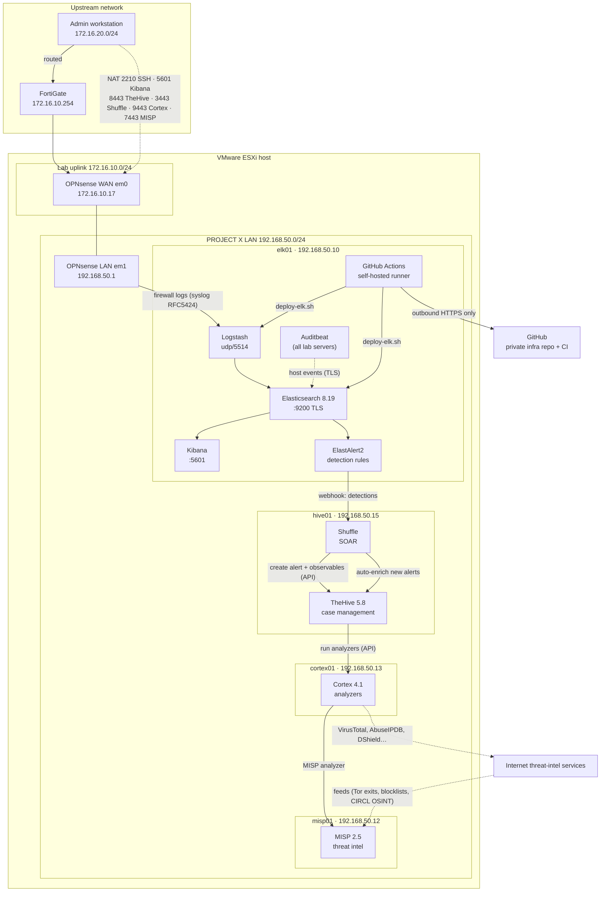

# ProjectX-NextGen-SOC

Architecture, build notes and configuration for **PROJECT X**, a SOC lab platform on VMware ESXi. It covers an OPNsense gateway, an Elastic SIEM, and a CI/CD pipeline that tests and deploys configuration changes automatically.

> All IP addresses and network names are placeholders. Passwords and keys are never committed.

## Architecture



## Components

| Component | Folder | Status |
|---|---|---|
| OPNsense gateway: WAN/LAN, NAT, remote logging | [`opnsense/`](opnsense/README.md) | ✅ Done |
| Elastic SIEM (Elasticsearch, Logstash, Kibana 8.19, single node) | [`elk/`](elk/README.md) | ✅ Ingesting and parsing OPNsense firewall logs into ECS |
| Retention: 90-day ILM, single-node replica fix | [`elk/`](elk/README.md#retention-and-index-settings) | ✅ Cluster green, deployed through CI/CD |
| CI/CD: tests, deploy with rollback, PR workflow | [`cicd/`](cicd/README.md) | ✅ Live on elk01 |
| TheHive 5.8: case management (Docker Compose, Community license) | [`hive01/`](hive01/README.md) | ✅ Running, organisation and users set up |
| Shuffle: SOAR, co-hosted with TheHive | [`hive01/`](hive01/README.md) | ✅ Running; creates TheHive alerts with observables |
| Cortex 4.1: observable enrichment (Abuse_Finder, DShield, Robtex), connected to TheHive | [`cortex01/`](cortex01/README.md) | ✅ Running; analyzers run from TheHive observables |
| MISP 2.5: threat-intel feeds (Tor exits, blocklist.de, Feodo C2, CIRCL OSINT), searched by Cortex | [`misp01/`](misp01/README.md) | ✅ Running; demo attacker matched to Tor exit feed automatically |
| Automatic enrichment: every new alert runs all matching analyzers (Shuffle) | [`shuffle/`](shuffle/auto-enrich.py) | ✅ Live (VirusTotal, AbuseIPDB, DShield, Robtex, Abuse_Finder, MISP) |
| Detections: ElastAlert2 → Shuffle → TheHive | [`elastalert/`](elastalert/README.md) | ✅ 7 rules live: 4 network (port scan, SSH brute force, LAN host sweep, block burst) + 3 host (failed logins, recon tool, new user), all MITRE-mapped |
| Detection rules as code: CI checks + deploy with rollback | [`cicd/`](cicd/README.md), [`elastalert/`](elastalert/README.md) | ✅ Live |
| Host telemetry: Auditbeat on all 4 Linux servers (logins, user commands, account and file changes) | [`auditbeat/`](auditbeat/README.md) | ✅ Live; lab-to-lab SSH brute force detected (invisible to the firewall) |
| MITRE ATT&CK technique on every alert (TTPs tab) | [`hive01/`](hive01/README.md) | ✅ Live |
| OpenCTI | | ⏳ Planned (after submission) |

## How changes are made

1. Edit the configuration on a branch and open a pull request.
2. CI runs: YAML/JSON lint, secret scan, `logstash -t`, a parser test using **real OPNsense log lines**, and detection-rule checks.
3. Merge to `main` after CI passes.
4. The runner on elk01 deploys: validate → backup → apply → restart only what changed → health check → **automatic rollback** if unhealthy.

Details and the security model are in [`cicd/README.md`](cicd/README.md). The team guide for adding new log sources or services is [`cicd/ADDING-INTEGRATIONS.md`](cicd/ADDING-INTEGRATIONS.md).

## Repository layout

```
opnsense/       Gateway build: interfaces, IP plan, firewall/NAT rules, gotchas
elk/            SIEM build: configs, Logstash pipeline, retention objects, gotchas
  elasticsearch/   elasticsearch.yml, heap, API objects (ILM, component template)
  kibana/          kibana.yml additions
  logstash/        conf.d/ split pipeline, tests/ sample logs
elastalert/     Detection rules (ElastAlert2): config, rules, service, build notes
auditbeat/      Host telemetry: Auditbeat config (CI-tested) for all Linux servers
misp01/         Threat intelligence: MISP stack, feeds, Cortex integration, gotchas
shuffle/        SOAR logic kept in Git (auto-enrichment step)
demo/           Attack simulator: synthetic firewall logs through the whole pipeline
cortex01/       Observable analysis: Cortex stack, analyzers, TheHive connector, gotchas
hive01/         Case management + SOAR: TheHive and Shuffle stacks, ports, users, gotchas
cicd/           Pipeline reference: workflow, test + deploy scripts, integration guide
```

## Key design decisions

| Decision | Reason |
|---|---|
| OPNsense as the lab gateway | Isolates the SOC lab LAN from the shared ESXi segment; one controlled entry point |
| Logstash on udp/5514, not 514 | Logstash runs unprivileged and cannot bind below 1024; OPNsense can send to any port, so no rsyslog relay |
| ECS field names | The parsed data works directly with Kibana Security and future detection rules |
| Data streams + `logs@custom` | Use Elastic's built-in `logs` template and override only what's needed, so upgrades stay clean |
| Private infra repo, public docs repo | Real IPs and pipeline stay private; this repo shows the architecture safely |
| TheHive and Shuffle on one VM, separate Compose stacks | Matches the architecture plan (host .15); each product keeps its own datastore (TheHive's Elasticsearch is not the SIEM's) and can be upgraded independently |
| Integration accounts as TheHive *Service* users | API-only, least privilege (`analyst`), and they don't consume licensed seats |
| ElastAlert2 instead of Kibana connectors | Kibana's webhook connector needs a paid Elastic license; ElastAlert2 is open source and its rules are YAML that fits the CI pipeline |
| MISP queried through Cortex, not a direct TheHive import | Every alert gets an IOC match result without flooding TheHive with thousands of feed events as alerts |
| Cortex on its own VM | StrangeBee recommends 16 GB for Cortex + its Elasticsearch; analyzers run as extra containers, so it doesn't share hive01's memory |
| Self-hosted runner, root-owned deploy script | Deploys from inside the lab with no inbound access; the repo cannot change what runs as root |

## Commissioning demo (video)

▶ **[Watch the end-to-end demo](https://github.com/PENDUSTAA/ProjectX-NextGen-SOC-/releases/tag/v1.0)** (recorded 19 Oct 2026, attached to release v1.0)

| Scene | What it proves |
|---|---|
| 1 | Platform running: services active, cluster green, 90-day retention policy |
| 2 | Firewall logs and host telemetry from all 4 servers arriving in Elasticsearch |
| 3 | Simulated port scan from a Tor exit node detected by ElastAlert2 |
| 4 | Alert created in TheHive automatically, with MITRE ATT&CK T1046 |
| 5 | Automatic enrichment: VirusTotal, AbuseIPDB, DShield, MISP Tor-exit match |
| 6 | SSH brute force between two lab servers: detected from host logs, invisible to the firewall |
| 7 | Attacker tool (nmap) and new local account detected (T1046, T1136) |
| 8 | Change control: merged pull requests and green CI/CD pipeline |

## Roadmap (Phase 2, Nov 2026 – Jan 2027)

| ID | Item | Value |
|---|---|---|
| B-01 | Hardening: internal CA with TLS verification on, per-host credentials, restricted firewall management | Production-grade security |
| B-02 | Backups: Elasticsearch snapshots, TheHive/Cortex/MISP data, firewall configuration | Recovery from VM or disk failure |
| B-03 | Commercial data sources: FortiGate, Palo Alto, CrowdStrike Falcon, Cortex XDR | Visibility across the MSS client estate |
| B-04 | Response playbooks: auto-block, host isolation, auto-close of false positives | Automated response (MTTR) |
| B-05 | Windows endpoint telemetry (Sysmon) with detection rules | Windows visibility |
| B-06 | OpenCTI; export of confirmed TheHive cases to MISP | Full threat-intelligence lifecycle |
| B-07 | n8n, Grafana, OpenVAS, NetBox, OpenCanary | Reporting, vulnerability management, asset context, deception |
| B-08 | Pilot client onboarding and UAT | First live MSS service |
