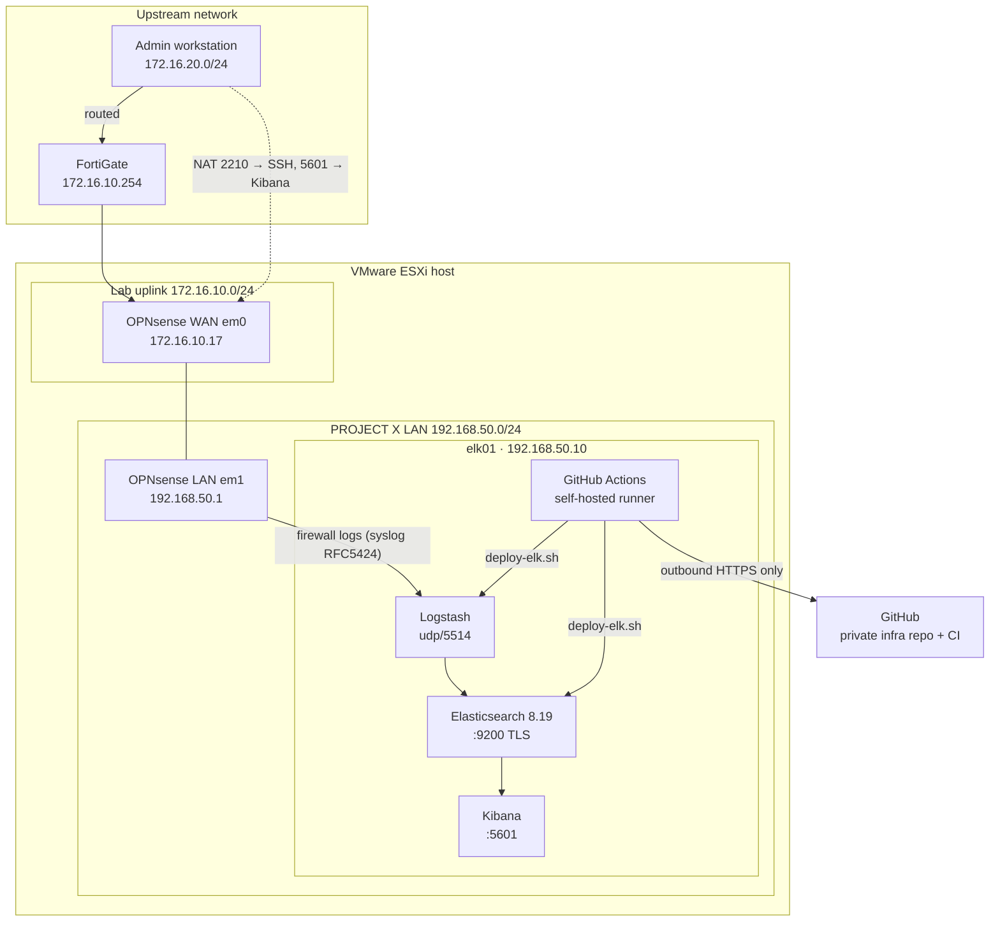

# SOC-REVAMP-Architecture

Architecture, build notes and configuration for **PROJECT X**, a SOC lab platform on VMware ESXi. It covers an OPNsense gateway, an Elastic SIEM, and a CI/CD pipeline that tests and deploys configuration changes automatically.

> All IP addresses and network names are placeholders. Passwords and keys are never committed.

## Architecture



## Components

| Component | Folder | Status |
|---|---|---|
| OPNsense gateway: WAN/LAN, NAT, remote logging | [`opnsense/`](opnsense/README.md) | ✅ Done |
| Elastic SIEM (Elasticsearch, Logstash, Kibana 8.19, single node) | [`elk/`](elk/README.md) | ✅ Ingesting and parsing OPNsense firewall logs into ECS |
| Retention: 90-day ILM, single-node replica fix | [`elk/`](elk/README.md#retention-and-index-settings) | ✅ Cluster green, deployed through CI/CD |
| CI/CD: tests, deploy with rollback, PR workflow | [`cicd/`](cicd/README.md) | ✅ Live on elk01 |
| Detection rules (port scan, brute force, lateral scan, block spikes) | | ⏳ Planned |
| TheHive, MISP, OpenCTI, Shuffle | | ⏳ Planned |

## How changes are made

1. Edit the configuration on a branch and open a pull request.
2. CI runs: YAML/JSON lint, secret scan, `logstash -t`, and a parser test using **real OPNsense log lines**.
3. Merge to `main` after CI passes.
4. The runner on elk01 deploys: validate → backup → apply → restart only what changed → health check → **automatic rollback** if unhealthy.

Details and the security model are in [`cicd/README.md`](cicd/README.md). The team guide for adding new log sources or services is [`cicd/ADDING-INTEGRATIONS.md`](cicd/ADDING-INTEGRATIONS.md).

## Repository layout

```
opnsense/       Gateway build: interfaces, IP plan, firewall/NAT rules, gotchas
elk/            SIEM build: configs, Logstash pipeline, retention objects, gotchas
  elasticsearch/   elasticsearch.yml, heap, API objects (ILM, component template)
  kibana/          kibana.yml additions
  logstash/        conf.d/ split pipeline, tests/ sample logs
cicd/           Pipeline reference: workflow, test + deploy scripts, integration guide
```

## Key design decisions

| Decision | Reason |
|---|---|
| OPNsense as the lab gateway | Isolates the SOC lab LAN from the shared ESXi segment; one controlled entry point |
| Logstash on udp/5514, not 514 | Logstash runs unprivileged and cannot bind below 1024; OPNsense can send to any port, so no rsyslog relay |
| ECS field names | The parsed data works directly with Kibana Security and future detection rules |
| Data streams + `logs@custom` | Use Elastic's built-in `logs` template and override only what's needed, so upgrades stay clean |
| Private infra repo, public docs repo | Real IPs and pipeline stay private; this repo shows the architecture safely |
| Self-hosted runner, root-owned deploy script | Deploys from inside the lab with no inbound access; the repo cannot change what runs as root |
