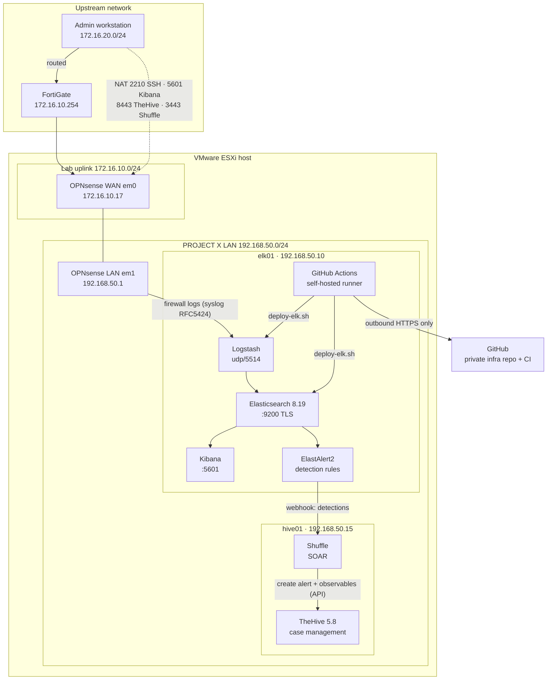

# SOC-REVAMP-Architecture

Architecture, build notes and configuration for **PROJECT X**, a SOC lab platform on VMware ESXi. It covers an OPNsense gateway, an Elastic SIEM, and a CI/CD pipeline that tests and deploys configuration changes automatically.

> All IP addresses and network names are placeholders. Passwords and keys are never committed.

## Architecture



## Components

| Component | Folder | Status |
|---|---|---|
| OPNsense gateway: WAN/LAN, NAT, remote logging | [`opnsense/`](opnsense/README.md) | ✅ Done |
| Elastic SIEM (Elasticsearch, Logstash, Kibana 8.19, single node) | [`elk/`](elk/README.md) | ✅ Ingesting and parsing OPNsense firewall logs into ECS |
| Retention: 90-day ILM, single-node replica fix | [`elk/`](elk/README.md#retention-and-index-settings) | ✅ Cluster green, deployed through CI/CD |
| CI/CD: tests, deploy with rollback, PR workflow | [`cicd/`](cicd/README.md) | ✅ Live on elk01 |
| TheHive 5.8: case management (Docker Compose, Community license) | [`hive01/`](hive01/README.md) | ✅ Running, organisation and users set up |
| Shuffle: SOAR, co-hosted with TheHive | [`hive01/`](hive01/README.md) | ✅ Running; creates TheHive alerts with observables |
| Detections: ElastAlert2 → Shuffle → TheHive | [`elastalert/`](elastalert/README.md) | ✅ 4 rules live, each tested end to end: port scan, SSH brute force, LAN host sweep, block spike |
| Detection rules as code: CI checks + deploy with rollback | [`cicd/`](cicd/README.md), [`elastalert/`](elastalert/README.md) | ✅ Live |
| Lab-internal (east-west) detection | | ⏳ Needs host telemetry (traffic between LAN hosts never crosses the firewall) |
| MITRE technique on TheHive alerts (TTPs tab) | | ⏳ Planned |
| Cortex, MISP, OpenCTI | | ⏳ Planned |

## How changes are made

1. Edit the configuration on a branch and open a pull request.
2. CI runs: YAML/JSON lint, secret scan, `logstash -t`, a parser test using **real OPNsense log lines**, and detection-rule checks.
3. Merge to `main` after CI passes.
4. The runner on elk01 deploys: validate → backup → apply → restart only what changed → health check → **automatic rollback** if unhealthy.

Details and the security model are in [`cicd/README.md`](cicd/README.md). The team guide for adding new log sources or services is [`cicd/ADDING-INTEGRATIONS.md`](cicd/ADDING-INTEGRATIONS.md).

## Repository layout

```
opnsense/       Gateway build: interfaces, IP plan, firewall/NAT rules, gotchas
elk/            SIEM build: configs, Logstash pipeline, retention objects, gotchas
  elasticsearch/   elasticsearch.yml, heap, API objects (ILM, component template)
  kibana/          kibana.yml additions
  logstash/        conf.d/ split pipeline, tests/ sample logs
elastalert/     Detection rules (ElastAlert2): config, rules, service, build notes
hive01/         Case management + SOAR: TheHive and Shuffle stacks, ports, users, gotchas
cicd/           Pipeline reference: workflow, test + deploy scripts, integration guide
```

## Key design decisions

| Decision | Reason |
|---|---|
| OPNsense as the lab gateway | Isolates the SOC lab LAN from the shared ESXi segment; one controlled entry point |
| Logstash on udp/5514, not 514 | Logstash runs unprivileged and cannot bind below 1024; OPNsense can send to any port, so no rsyslog relay |
| ECS field names | The parsed data works directly with Kibana Security and future detection rules |
| Data streams + `logs@custom` | Use Elastic's built-in `logs` template and override only what's needed, so upgrades stay clean |
| Private infra repo, public docs repo | Real IPs and pipeline stay private; this repo shows the architecture safely |
| TheHive and Shuffle on one VM, separate Compose stacks | Matches the architecture plan (host .15); each product keeps its own datastore (TheHive's Elasticsearch is not the SIEM's) and can be upgraded independently |
| Integration accounts as TheHive *Service* users | API-only, least privilege (`analyst`), and they don't consume licensed seats |
| ElastAlert2 instead of Kibana connectors | Kibana's webhook connector needs a paid Elastic license; ElastAlert2 is open source and its rules are YAML that fits the CI pipeline |
| Self-hosted runner, root-owned deploy script | Deploys from inside the lab with no inbound access; the repo cannot change what runs as root |
