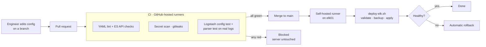

# CI/CD – configuration as code for PROJECT X

Lab configuration lives in a **private** Git repository. Every change is tested automatically before it can reach a server, then deployed by a runner inside the lab, with validation, backup, health checks and automatic rollback.

This folder holds reference copies of that pipeline, with IPs replaced by placeholders. The scripts reference the private repo's layout (`ci/`, `elk/`, `.github/workflows/`), so they are documentation here, not runnable as-is.

## Why

Before this, changing the SIEM meant SSH, editing a file in `nano`, restarting, and hoping. Two real incidents during the build came from exactly that:

- `elasticsearch.yml` was wiped during an edit, and Elasticsearch would not start.
- A password mismatch put Logstash into a restart loop, and logs silently stopped.

With the pipeline, both would be caught before deploy. Lint catches the broken YAML; the deploy's health check fails and **rolls back** on the second.

## Flow

## CI checks (every push and pull request)

| Job | What it checks | Real catch during the build |
|---|---|---|
| Lint (YAML + ES API) | YAML syntax; JSON valid; every ILM policy keeps a **delete phase**; every template references a policy that exists | Would have caught the wiped `elasticsearch.yml` |
| Secret scan | gitleaks default rules + a custom rule for literal `password =>` in configs | Blocks committing credentials |
| Logstash config test | `logstash -t` on the full pipeline in a container | Pipeline syntax errors |
| Parser test | Feeds **real OPNsense log lines** through the filter and asserts ECS fields (actions, IPs, ports as numbers, no stray fields) | Found a duplicate `syslog_msg` field on every event on its first run |
| ElastAlert2 rules | Same ElastAlert2 version as production: schema check with readable errors, rule name = file name, alerts only to the **webhook placeholder** (fails if a real Shuffle URL is committed), payload carries the fields the Shuffle → TheHive workflow needs and renders to valid JSON against a sample event | Readable errors for typos (`unknown rule type 'cardinalty'`) instead of ElastAlert2's generic schema message |

Scripts: [`scripts/test-elastalert-rules.py`](scripts/test-elastalert-rules.py), [`scripts/test-logstash-filter.sh`](scripts/test-logstash-filter.sh), [`scripts/test-logstash-config.sh`](scripts/test-logstash-config.sh), [`scripts/test-es-api.sh`](scripts/test-es-api.sh). Workflow: [`workflow/ci.yml`](workflow/ci.yml).

## Deploy (merge to `main`)

A GitHub Actions **self-hosted runner** on elk01 picks up the deploy job. It only makes outbound HTTPS connections to GitHub, so no inbound firewall rule into the lab is needed.

[`scripts/deploy-elk.sh`](scripts/deploy-elk.sh) runs each component in order (Elasticsearch → Elasticsearch API objects → Logstash → ElastAlert2 rules) through the same steps:

| Step | Detail |
|---|---|
| 1. Compare | Repo vs live; nothing to do if identical |
| 2. Validate | `logstash -t` on a staged copy; required keystore keys present; Elasticsearch login works |
| 3. Backup | Current files and API objects to `/var/backups/projectx/<timestamp>/` |
| 4. Apply | Copy files / `PUT` API objects |
| 5. Restart | **Only** the service that changed |
| 6. Health check | Logstash listening on its port (still up 20 s later); Elasticsearch answering; API objects read back and compared |
| 7. Rollback | On any failed health check, restore the backup and restart |

ElastAlert2 specifics: the real Shuffle webhook URL is inserted from a root-only file on the host at deploy time; every diff and log line is passed through a redaction filter so the URL never reaches CI logs; rules deleted from the repo are removed from the host; healthy = service still active 45 s after restart with no rule-load errors.

A `check` mode shows the exact diff without applying anything. It is used as a dry run before every first deploy of a new component.

## Security design

| Control | How |
|---|---|
| Least privilege on the host | Runner runs as `gh-runner` (no password, home mode 750); sudo allows **one** command: the deploy script |
| Repo cannot change what root runs | The deploy script is installed root-owned at `/opt/projectx/` by an admin after reviewing its diff, and is not executed from the checkout |
| Least privilege in Elasticsearch | `logstash_writer` can only write `logs-opnsense-*`; `projectx_deployer` can only manage ILM policies and templates |
| No secrets in Git | Passwords live in the Logstash keystore and root-only env files on the host; gitleaks enforces this in CI, and the rule test blocks real webhook URLs |
| Credentials not exposed at runtime | The deploy script passes Elasticsearch credentials to curl via stdin, not command-line arguments |
| Path restriction | The deploy script refuses any checkout path outside the runner's work directory |
| Change gate | Pull request + green CI before merge; deploys serialised (one at a time) |

## Verified scenarios

The deploy script was tested against a simulated host before use on elk01:

| Scenario | Result |
|---|---|
| Check mode | Diff shown, nothing applied |
| Missing keystore key | Stopped before any change |
| Logstash config test fails | Stopped before any change |
| Logstash unhealthy after restart | Rolled back automatically |
| Good change | Applied, only Logstash restarted |
| Re-run with no changes | "Nothing to deploy" |
| Elasticsearch API: new objects, re-run, rejected PUT, wrong password, missing credentials | Applied and verified, idempotent, stopped safely, clear error, clear error |
| ElastAlert2: no change, check mode, threshold change, schema-invalid rule, service unhealthy after restart, rule added then deleted, missing webhook file | Nothing to deploy; diff only; applied + restarted; stopped before any change; rolled back; added then removed; clear error. Webhook ID never appeared in output |

## Adding integrations

[`ADDING-INTEGRATIONS.md`](ADDING-INTEGRATIONS.md) is the guide for the team: a new log source (e.g. FortiGate) needs only config files, real sample lines and test assertions, with no deploy changes. A new service gets a CI validator and a deploy function from a template.

## Build notes

1. **Runner installed under the wrong user.** `useradd` had not run, so `sudo -iu gh-runner` failed and the runner was installed under the admin user. Check `id gh-runner` and `whoami` before downloading.
2. **Truncated runner download.** No `bin/` folder after extraction. Download with `curl -f` and confirm `bin/Runner.Listener` exists before configuring.
3. **Missing `--labels`.** The deploy job targets `[self-hosted, elk01]`; without the label the job never gets picked up.
4. **Home directory mode 750 (Ubuntu 24.04).** The admin user cannot `cd` into `/home/gh-runner`; run `svc.sh` via `sudo bash -c 'cd … && ./svc.sh install gh-runner'`.
5. **Failures surfaced as annotations.** Test scripts emit GitHub annotations (`::error::`) with the failing check and the parsed event, so the cause shows on the run summary page without digging through job logs.
6. **Logstash loads every file in its `-f` directory.** The parser test first wrote its output next to the pipeline files, and Logstash tried to parse it as config. Test pipelines get their own folder.
